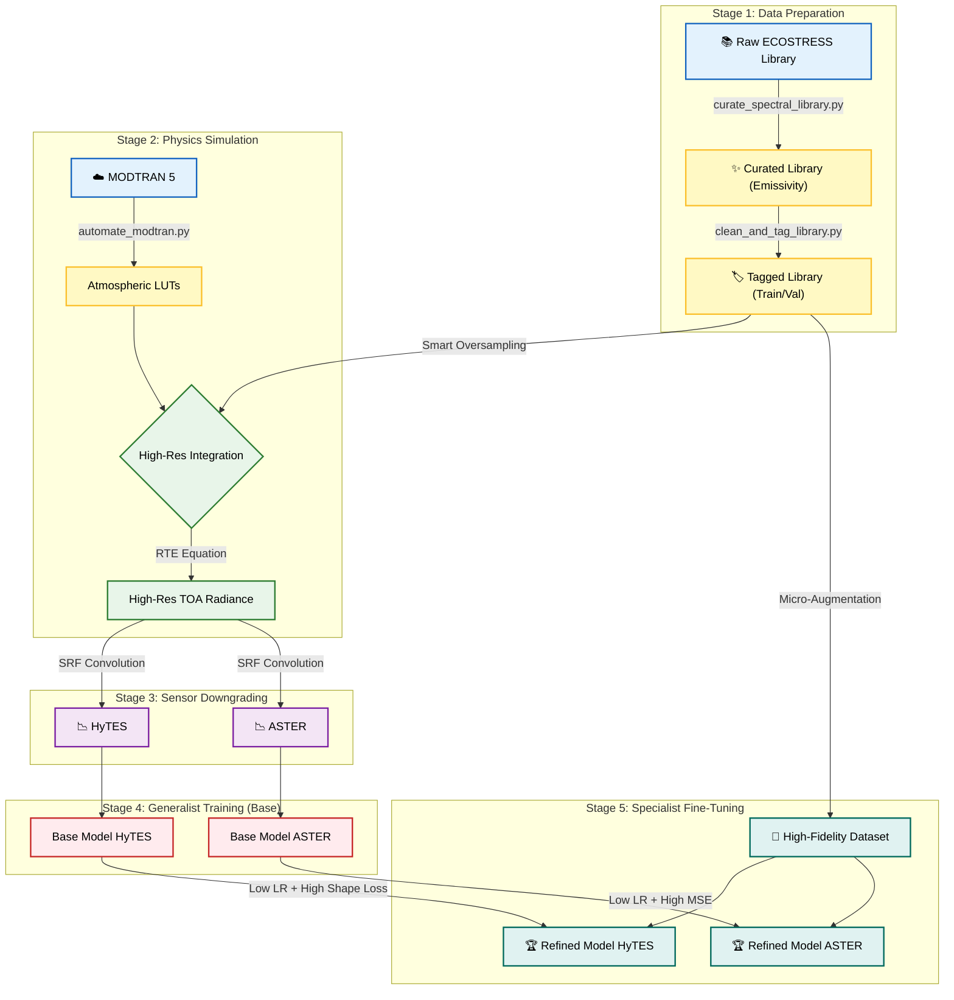
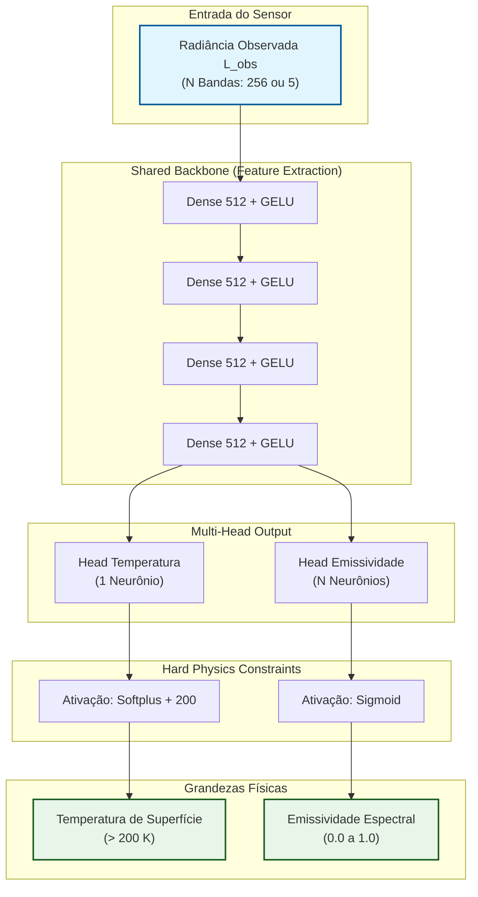
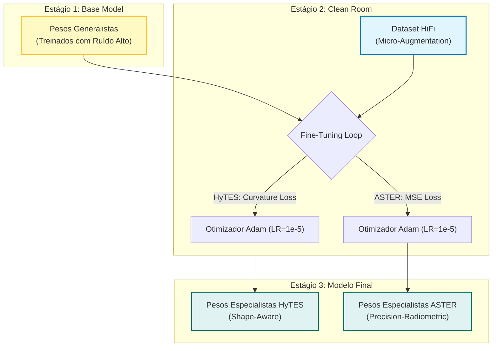

# 🌡️ IATIR - Inverse Analysis of Thermal Infrared

**Versão**: 2.2 (Fine-Tuning Enabled)
**Engine**: PyTorch + PINNs (Physics-Informed Neural Networks)
**Arquitetura**: Multi-Head Neural Network (Temperature & Emissivity Separation) + Specialist Refinement

  

## 📋 Índice

1. [Introdução e Conceito](#1-introdução-e-conceito)
2. [Arquitetura do Sistema](#2-arquitetura-do-sistema)
3. [Modelo de Dados (Deep Dive)](#3-modelo-de-dados-deep-dive)
4. [Modelo Neural (PINN Architecture)](#4-modelo-neural-pinn-architecture)
5. [Estrutura do Projeto](#5-estrutura-do-projeto)
6. [Instalação e Configuração](#6-instalação-e-configuração)
7. [Operação do Sistema](#7-operação-do-sistema)
   - [7.1. Preparação de Dados](#71-preparação-de-dados-golden-library)
   - [7.2. Pipeline HyTES (Generalista + Especialista)](#72-pipeline-hytes)
   - [7.3. Pipeline ASTER (Generalista + Especialista)](#73-pipeline-aster)
   - [7.4. Visualização e Inferência](#74-visualização-e-inferência)
8. [Troubleshooting](#8-troubleshooting)

---

## 1. Introdução e Conceito

O **IATIR** resolve o problema inverso mal-posto da separação de **Temperatura e Emissividade (TES)** em sensoriamento remoto termal. O sistema utiliza **Redes Neurais Informadas pela Física (PINNs)** para garantir que as predições de radiância respeitem a Lei de Planck, a continuidade espectral e as características atmosféricas.

### 1.1. Equação de Transferência Radiativa (RTE)
A base física do modelo é a simulação rigorosa da radiância no topo da atmosfera ($L_{obs}$), considerando a absorção e emissão atmosférica geradas pelo MODTRAN:

$$L_{obs}(\lambda) = \tau(\lambda)\epsilon(\lambda)B(\lambda, T_s) + L_{up}(\lambda) + \tau(\lambda)[1 - \epsilon(\lambda)]L_{down}(\lambda)$$

* **$T_s$ (Temperatura Cinética)**: Variada aleatoriamente entre **280K e 330K** durante o treino para garantir generalização térmica.
* **$\epsilon(\lambda)$ (Emissividade)**: Provém da biblioteca real (ECOSTRESS), preservando a diversidade química dos materiais.

### 1.2. Simulação Dual-Sensor
O sistema opera com dados convoluídos pelas Funções de Resposta Espectral (SRF) de dois sensores distintos, permitindo validar a arquitetura em cenários de alta e baixa resolução:

1.  **HyTES (Hiperspectral)**: 256 bandas (7.5 - 12 $\mu m$). Alta resolução, permitindo ao modelo derivar curvatura espectral e identificar minerais por "shape".
2.  **ASTER (Multiespectral)**: 5 bandas (TIR). Baixa resolução, onde o modelo é forçado a depender de precisão radiométrica absoluta.

---

## 2. Arquitetura do Sistema

O fluxo detalhado abrange desde a aquisição de dados brutos, passando pela simulação física (RTE), treinamento "Generalista" e finalmente o **Refinamento "Especialista"** (Fine-Tuning).



---

## 3. Modelo de Dados (Deep Dive)

A espinha dorsal do **IATIR** é a sua base de dados híbrida, combinando a física do transporte radiativo (MODTRAN) com a diversidade química real de materiais geológicos e urbanos.

### 3.1. Fonte de Dados (ECOSTRESS Spectral Library)
Utilizamos o *dump* completo da **ECOSTRESS Spectral Library (antiga ASTER JHU)**, contendo mais de 6.000 espectros de laboratório.
Um pipeline de ETL (`src/data_generation/`) foi desenvolvido para:
1.  **Mineração:** Filtrar apenas alvos de interesse (Quartzo, Calcita, Caulinita, Feldspato, Concreto, Asfalto, Vegetação).
2.  **Conversão Física:** Transformar dados de Reflectância Bidirecional ($R$) em Emissividade Direcional ($\epsilon$) aplicando a Lei de Kirchhoff para corpos opacos: $\epsilon(\lambda) = 1.0 - R(\lambda)$.
3.  **Filtragem Espectral:** Recortar e interpolar os dados estritamente para a janela do Infravermelho Termal (8.0 a 12.0 $\mu m$), ajustando para as bandas dos sensores HyTES (256 canais) e ASTER (5 canais).

### 3.2. Estratégia de Validação ("Golden Targets")
Para garantir uma avaliação honesta e evitar *data leakage*, adotamos uma estratégia de **"Endmembers Puros"**. Selecionamos manualmente 7 arquivos de referência que representam a física ideal de cada classe.
**Regra de Ouro:** Estes arquivos são isolados fisicamente e **NUNCA** são vistos pela rede neural durante o treinamento ou augmentation. Eles servem exclusivamente para a validação final (linhas pretas nos gráficos).

* **Minerais:** Quartz (Coarse), Calcite (Coarse), Kaolinite, Feldspar (Anorthite).
* **Urbanos:** Urban Concrete (Solid), Urban Asphalt (Paving).
* **Vegetação:** Green Leaf (Bark/Foliage).

### 3.3. Engenharia de Datasets (Smart Oversampling)
O banco de dados real apresentava um desbalanceamento severo (~1.200 amostras de Vegetação vs. ~20 amostras de Quartzo). O uso de *Undersampling* (remover vegetação) foi descartado para não perder variância biológica.
Em vez disso, aplicamos **Smart Oversampling com Perturbação Espectral**:
1.  **Classe Majoritária (Vegetação):** Mantida original (~1.160 arquivos).
2.  **Classes Minoritárias (Minerais):** Clonadas e perturbadas matematicamente até atingir a contagem da majoritária.

Isso garante que a rede veja minerais com a mesma frequência que vê vegetação, eliminando o viés de classe.

### 3.4. Hierarquia de Treinamento (Curriculum Learning)
Criamos dois níveis de datasets com diferentes perfis de ruído para suportar a estratégia de *Transfer Learning*:

| Dataset | Estágio de Uso | Objetivo | Augmentation (Ruído) |
| :--- | :--- | :--- | :--- |
| **Standard Dataset** | Treino Generalista | **Robustez e Generalização.** Impede que a rede "decore" as poucas amostras minerais originais. | **Médio:** Amplitude $\pm 0.5\%$ <br> Aditivo $\pm 0.002$ |
| **High-Fidelity (HiFi)** | Fine-Tuning (Especialista) | **Precisão Espectral.** Ensina a rede a confiar na forma exata dos picos de absorção (recuperação de vales). | **Micro:** Amplitude $\pm 0.1\%$ <br> Aditivo $\pm 0.0005$ |

> **Nota:** O dataset HiFi reside na "Clean Room" (`src/model_fine_tuning/`) e é utilizado com taxas de aprendizado muito baixas ($10^{-5}$) para refinar os pesos sem destruir o conhecimento prévio.

---

## 4. Modelo Neural (PINN Architecture)

A rede neural (`src/models/pinn.py`) utiliza uma topologia **Multi-Head MLP** robusta. Ela processa a radiância de entrada através de um *backbone* compartilhado para extrair features latentes e, em seguida, bifurca-se em duas cabeças especializadas para predizer grandezas físicas distintas (Temperatura e Emissividade).

### 4.1. Arquitetura e Fluxo de Dados

**Topologia PINN (Multi-Head):**



**Fluxo de Refinamento (Transfer Learning):**




### 4.2. Restrições Físicas (Hard Constraints)
Para garantir que a rede nunca viole a termodinâmica (ex: temperaturas negativas ou emissividade > 1), aplicamos funções de ativação específicas na camada de saída:

| Variável | Ativação | Interpretação Física |
| :--- | :--- | :--- |
| **Temperatura ($T_s$)** | $T = \text{Softplus}(x) + 200.0$ | Garante $T > 200K$. |
| **Emissividade ($\epsilon$)** | $\epsilon = \text{Sigmoid}(x)$ | Garante $0 \le \epsilon \le 1$. |

### 4.3. Evolução dos Parâmetros (Generalist vs Specialist)
O treinamento segue uma estratégia de *Curriculum Learning*. Abaixo, a comparação entre o primeiro treino (Generalista 1.0), o ajuste robusto proposto (2.0) e o refinamento final:

| Categoria | Parâmetro | Generalista 1.0 (Deprecated) | Generalista 2.0 (Atual/Proposto) | Especialista (Fine-Tuning) |
| :--- | :--- | :--- | :--- | :--- |
| **Geração de Dados** | Ruído de Amplitude | $\pm 1.0\%$ | $\pm 0.5\%$ | $\pm 0.1\%$ |
| *(Robustez)* | Ruído Aditivo | 0.005 | 0.002 | 0.0005 |
| | *Interpretação* | Muito ruidoso. Rede ignora detalhes finos. | **Equilibrado**. Permite ver absorções sutis. | Quase puro. Precisão cirúrgica. |
| **Treinamento** | MSE Emissividade (`w_mse_eps`) | **10.0** (V1 Legacy) | 100.0 (V2 Default) | 100.0 (HyTES) / 10.0 (ASTER) |
| *(Pesos da Loss)* | MSE Temperatura (`w_mse_t`) | 1.0 | 1.0 | 1.0 |
| | Physics Error (ou SAM/Shape) | **0.1** (Constraint) | 1.0 (SAM) + 0.5 (Grad) | 1.0 (SAM) + 2.0 (Grad) |
| | Curvatura ($\Delta^2$) (`w_curv`) | N/A (Era implicita) | **0.5** (Boosted) | **2.0** (HyTES) / **0.0** (ASTER) |
| *(Física)* | Foco Principal | Média Estatística (MSE) | Forma + Média (Híbrido) | Derivada/Forma (Shape) |

### 4.4. Refinamento (Fine-Tuning Parameters)
O refinamento é cirúrgico e adaptado à resolução espectral de cada sensor:

| Parâmetro | HyTES (Refined) | ASTER (Refined) | Explicação |
| :--- | :--- | :--- | :--- |
| **Learning Rate** | `1e-5` | `1e-5` | Muito baixo para preservar o conhecimento prévio. |
| **Epochs** | 50 | 50 | Ciclo curto de especialização. |
| **Shape Loss (Curvature)** | **2.0** (Alto) | **0.0** (OFF) | HyTES tem resolução para derivar curvatura; ASTER (5 pontos) não. |
| **MSE Weight** | 100.0 | **10.0** | ASTER foca na precisão radiométrica absoluta dos pontos. |

#### 4.5. Função de Custo Híbrida (Hybrid Loss)

Durante o refinamento, a função de custo é composta por múltiplos termos ponderados para equilibrar precisão estatística e coerência física:

$$\mathcal{L}_{Total} = w_e MSE_{\epsilon} + w_t MSE_{T} + w_{sam} SAM + w_{grad} \nabla + w_{curve} \nabla^2$$

* **$MSE_{\epsilon, T}$**: Erro quadrático médio da Emissividade e Temperatura.
* **$SAM$**: Spectral Angle Mapper (preserva a forma vetorial do espectro).
* **$\nabla$ (Gradiente)**: Penaliza erros na 1ª derivada (inclinação/slope).
* **$\nabla^2$ (Curvatura)**: Penaliza erros na 2ª derivada (concavidade/convexidade), essencial para recuperar os "vales" de absorção do Quartzo e Caulinita no HyTES.
---

## 5. Estrutura do Projeto

```text
IATIR/
├── data/
│   ├── raw/                  # Bibliotecas Espectrais
│   ├── processed/
│   │   ├── final_datasets/   # Datasets Standard [.pt]
├── outputs/                  # Modelos Base (Generalistas)
├── src/
│   ├── data_generation/      # ETL Pipeline
│   │   ├── base/             # Geração de Dados Standard (Generalista)
│   │   │   ├── curate_spectral_library.py
│   │   │   ├── automate_modtran.py
│   │   │   └── create_final_dataset.py
│   │   └── fine_tuning/      # Geração de Dados HiFi (Specialist)
│   │       ├── prepare_hifi_hytes.py
│   │       └── hifi_train_dataset.pt
│   ├── training/             # Scripts de Treinamento
│   │   ├── base/
│   │   │   └── train_generalist.py
│   │   └── fine_tuning/
│   │       ├── train_refine_hytes.py
│   │       └── refined_model_hytes.pth
│   ├── models/               # Arquitetura (PINN, Losses)
│   └── visualize_results.py  # Inferência
```

---

## 6. Instalação e Configuração

```powershell
git clone https://github.com/usuario/iatir.git
cd IATIR
python -m venv venv
.\venv\Scripts\activate
pip install -r requirements.txt
```

---

## 7. Operação do Sistema

### 7.1. Preparação de Dados (Golden Library)
Execute uma única vez para gerar a base de dados limpa.

```powershell
# 1. Curadoria e Limpeza
python src/data_generation/base/curate_spectral_library.py
python src/data_generation/base/clean_and_tag_library.py

# 2. (Opcional) MODTRAN Automation
python src/data_generation/base/automate_modtran.py
```

### 7.2. Pipeline HyTES
Fluxo completo para o sensor hiperspectral (256 bandas).

```powershell
# 1. Gerar Dataset Generalista
python src/data_generation/base/create_final_dataset.py --sensor hytes

# 2. Treinar Modelo Base (Generalista)
python src/training/base/train_generalist.py --sensor hytes --epochs 300
# Output: outputs/final_model_hytes.pth

# 3. Gerar Dataset 'High-Fidelity' (Fine-Tuning)
python src/data_generation/fine_tuning/prepare_hifi_hytes.py

# 4. Refinar Modelo (Especialista)
python src/training/fine_tuning/train_refine_hytes.py
# Output: src/training/fine_tuning/refined_model_hytes.pth
```

### 7.3. Pipeline ASTER
Fluxo completo para o sensor multiespectral (5 bandas).

```powershell
# 1. Gerar Dataset Generalista
python src/data_generation/base/create_final_dataset.py --sensor aster

# 2. Treinar Modelo Base (Generalista)
python src/training/base/train_generalist.py --sensor aster --epochs 300
# Output: outputs/final_model_aster.pth

# 3. Gerar Dataset 'High-Fidelity' (Fine-Tuning)
python src/data_generation/fine_tuning/prepare_hifi_aster.py

# 4. Refinar Modelo (Especialista)
python src/training/fine_tuning/train_refine_aster.py
# Output: src/training/fine_tuning/refined_model_aster.pth
```

### 7.4. Visualização e Inferência

A validação final é realizada exclusivamente nos **Golden Targets** (amostras puras não vistas no treino), utilizando as seguintes métricas:

* **RMSE (Root Mean Square Error)**: Mede a precisão radiométrica global da curva de emissividade recuperada.
* **Erro Absoluto de Temperatura ($\Delta T$)**: Diferença absoluta em Kelvin entre a predição e o Ground Truth ($|T_{pred} - T_{true}|$).
* **Inspeção Visual (Shape Matching)**: Sobreposição das curvas (Truth vs Base vs Refined) para verificar a recuperação de feições minerais agudas (ex: o "doublet" da Caulinita em 9-10 $\mu m$).

**Parâmetros Disponíveis (`src/visualize_results.py`):**

| Parâmetro | Valores Possíveis | Padrão | Descrição |
| :--- | :--- | :--- | :--- |
| `--mode` | `prediction`, `emissivity`, `temperature`, `all` | `prediction` | Tipo de gráfico. `all` gera todos. |
| `--sensor` | `hytes`, `aster`, `all` | `hytes` | Sensor alvo. `all` gera para ambos. |
| `--model_type` | `base`, `refined`, `all` | `base` | Modelo. `all` gera para ambos. |
| `--data` | `single`, `combined`, `all` | `single` | `single`: Apenas o modelo escolhido. `combined`: Sobrepõe Baseline sobre Refinado. `all`: Gera ambos. |
| `--save_only` | `flag` (sem valor) | `False` | Salva sem abrir janelas interativas. |

#### 7.4.1. Visualização HyTES (Hiperspectral)

*   **Prediction (Espectro Completo + Overlay)**:
    ```powershell
    python src/visualize_results.py --sensor hytes --mode prediction --model_type refined --data combined
    ```
*   **Emissivity (RMSE Médio)**:
    ```powershell
    python src/visualize_results.py --sensor hytes --mode emissivity --model_type refined --data combined
    ```

#### 7.4.2. Visualização ASTER (Multiespectral)

*   **Prediction (5 Bandas + Overlay)**:
    ```powershell
    python src/visualize_results.py --sensor aster --mode prediction --model_type refined --data combined
    ```

#### 7.4.3. Dica Pro: Geração em Lote (One-Shot)

O script agora possui inteligência interna para gerar **toda a validação** do projeto com um único comando:

```powershell
python src/visualize_results.py --sensor all --mode all --model_type all --data all --save_only
```

Isso criará automaticamente 18 gráficos na pasta `outputs/graphs/`, cobrindo todas as combinações de sensores, modos e comparações.

---

## 8. Troubleshooting

*   **Erro `ModuleNotFoundError`**: Lembre-se de rodar tudo dentro do ambiente virtual (`venv`). Use `venv\Scripts\python.exe` se necessário.

## 9. Files Description

### 📂 `src/` (Código Fonte)
Contém todo o código fonte do projeto, organizado por responsabilidade.

#### 📂 `src/data_generation/base/`
Scripts para construção do dataset padrão (Generalista).
- **`curate_spectral_library.py`**: Seleciona e copia arquivos alvo (quartzo, caulinita, etc.) da biblioteca bruta para a pasta limpa.
- **`clean_and_tag_library.py`**: Lê arquivos `.txt`, normaliza metadados e gera um log `csv` com tags de treino/validação.
- **`automate_modtran.py`**: Automação para rodar múltiplas simulações atmosféricas no software MODTRAN (Windows).
- **`simulate_sensor.py`**: Aplica a Equação de Transferência Radiativa (RTE) e convolui os dados com as curvas de resposta (SRF) dos sensores.
- **`create_final_dataset.py`**: Script principal que orquestra a criação dos arquivos `.pt` finais (Treino/Validação) com augmentation padrão.
- **`create_full_mock_library.py`**: Utilitário para gerar dados sintéticos em massa para testes de carga.
- **`create_kaolinite.py`**: Script auxiliar para gerar espectros sintéticos específicos de caulinita.
- **`generate_ground_truth.py`**: Gera o "Ground Truth" físico (temperatura e emissividade reais) a partir da biblioteca limpa.
- **`synthesize_dataset.py`**: Combina o Ground Truth com LUTs atmosféricas para criar a radiância no sensor.

#### 📂 `src/data_generation/fine_tuning/`
Scripts para construção do dataset de alta fidelidade (Especialista).
- **`prepare_hifi_hytes.py`**: Gera dataset `.pt` para HyTES com augmentation microscópico (HiFi).
- **`prepare_hifi_aster.py`**: Gera dataset `.pt` para ASTER com augmentation microscópico (HiFi).
- **`hifi_train_dataset.pt`**: Dados PyTorch (Tensor) de alta fidelidade para HyTES.
- **`hifi_train_dataset_aster.pt`**: Dados PyTorch (Tensor) de alta fidelidade para ASTER.

#### 📂 `src/training/base/`
Scripts de treinamento da primeira fase (Modelo Base).
- **`train_generalist.py`**: Treina a PINN do zero usando o dataset padrão com ruído moderado.

#### 📂 `src/training/fine_tuning/`
Scripts de treinamento da segunda fase (Refinamento).
- **`train_refine_hytes.py`**: Carrega o modelo base e refina com dados HiFi e Loss de Curvatura (HyTES).
- **`train_refine_aster.py`**: Carrega o modelo base e refina com dados HiFi focado em precisão radiométrica (ASTER).

#### 📂 `src/models/`
Definições das arquiteturas neurais e funções de custo.
- **`pinn.py`**: Classe `PhysicsInformedNN` definindo a rede Multi-Head MLP.
- **`losses.py`**: Implementação das funções de perda customizadas (`SpectralShapeLoss`, `SAM`, etc.).

#### 📂 `src/` (Raiz)
Scripts de utilidade geral e inferência.
- **`config.py`**: Arquivo central de configuração com parâmetros dos sensores (bandas, FWHM, caminhos).
- **`visualize_results.py`**: Gera gráficos de validação comparando Predição vs Realidade.
- **`generate_publication_figures.py`**: Script automatizado para gerar figuras padronizadas para artigos (Fig 1 e 2).

### 📂 `data/` (Dados)
Armazena todos os dados de entrada e saída intermédiarios.

#### 📂 `data/raw/`
- **`ecospeclib/`**: Pasta contendo os arquivos originais da biblioteca ECOSTRESS (não listados individualmente).
- **`spectral_libraries/`**: Biblioteca curada e limpa (arquivos `.txt` selecionados).

#### 📂 `data/processed/`
- **`final_datasets/`**: Contém os arquivos `.pt` (PyTorch Tensors) prontos para o treino base.
- **`atmospheric_luts/`**: Tabelas de "Look-Up" (LUTs) geradas pelo MODTRAN contendo transmitância e radiância atmosférica.
- **`hytes_real_parameters.csv`**: Arquivo com os centros de banda e larguras (FWHM) reais do sensor HyTES. Use este arquivo para simulação precisa.

### 📂 `outputs/`
- Contém os checkpoints dos modelos treinados (`.pth`) e gráficos de perda (`.png`).
---

## 10. Data Structure & Project Files

Este repositório contém o código-fonte, bibliotecas auxiliares e metadados. Devido ao grande volume de dados processados (~18GB), apenas os arquivos individuais gigantes listed abaixo **não foram carregados** no GitHub. Toda a estrutura de pastas e arquivos de controle (logs, CSVs de parâmetros e LUTs .txt) foram sincronizados.

### 📂 `data/processed/` (Arquivos GIGANTES Não Carregados)
Os arquivos abaixo devem ser gerados localmente conforme as instruções, pois excedem o limite de tamanho:

1.  **`ground_truth/ground_truth_dataset.pkl`** (~2GB)
    *   **O que é**: Ground Truth físico (Temperatura e Emissividade) completo.
    *   **Como gerar**: Execute `python src/data_generation/base/generate_ground_truth.py`.

2.  **`synthetic_dataset/synthetic_dataset_hytes.pt`** (~3GB)
    *   **O que é**: Dataset final em formato PyTorch Tensor para o sensor HyTES.
    *   **Como gerar**: Execute `python src/data_generation/base/create_final_dataset.py --sensor hytes`.

3.  **`final_datasets/*.pt`** (Volumes Variados)
    *   **O que é**: Tensores finais de treino e validação prontos para o modelo.
    *   **Como gerar**: Execute os scripts de treinamento ou geração de tensores finais.
