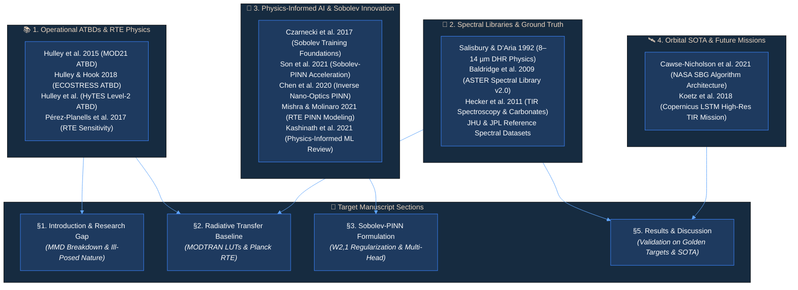
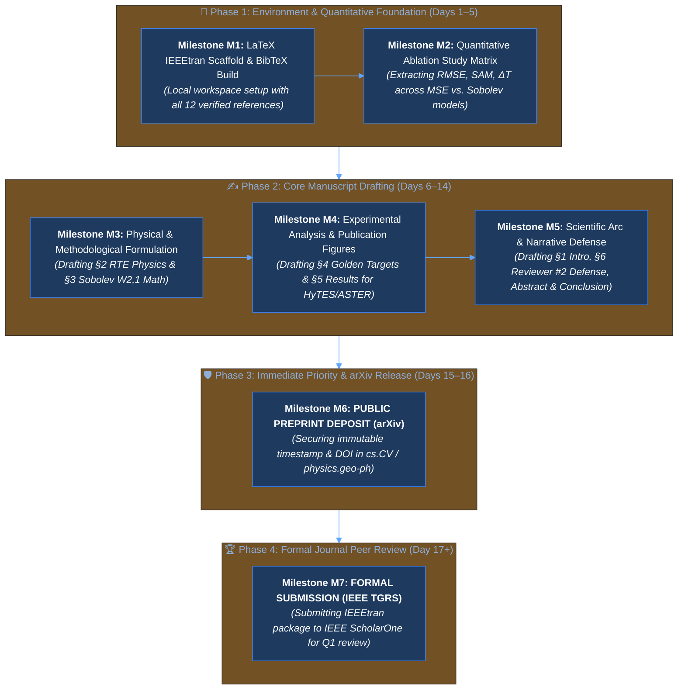

# 📄 Scientific Manuscript Implementation Plan: IATIR Project

**Publication Strategy:** Two-Stage Staged Dissemination  
1. **Preprint (Priority Stamp):** arXiv (Computer Vision & Pattern Recognition `cs.CV` / Geophysics `physics.geo-ph`)  
2. **Primary Target Journal:** *IEEE Transactions on Geoscience and Remote Sensing (IEEE TGRS)* (Impact Factor: 7.5, Q1 Top Tier)  
3. **Alternative Target:** *Remote Sensing of Environment (RSE)* (Impact Factor: 11.1, Q1)  
**Research Topic:** Physics-Informed Neural Networks with Sobolev Shape Regularization for Multispectral and Hyperspectral Thermal Infrared Temperature and Emissivity Separation (TES)  
**Author:** Dr. Atilio Grondona  

---

## 1. Editorial Recommendation: Journal Analysis & arXiv Strategy

### 1.1. Why Post on arXiv First? (The Strategic Advantage)
* **Scientific Priority & Anti-Scooping:** Depositing an unformatted or IEEEtran-formatted preprint establishes an immutable, timestamped DOI/identifier for the **Discrete 1D Sobolev ($W^{2,1}$) Shape Loss** and **Multi-Head PINN for TES**.
* **Preprint Policy Compliance:** Both **IEEE** and **Elsevier** operate under permissive Green Open Access policies: they explicitly allow preprints on arXiv prior to and during peer review.
* **Early Citations & Community Feedback:** Enables sharing preliminary findings with peers at NASA JPL, ESA, and universities while undergoing journal review.

---

### 1.2. Editorial Comparison & Journal Recommendation

| Evaluation Metric | **IEEE TGRS** *(Recommended #1)* | **Remote Sensing of Environment (RSE)** |
| :--- | :--- | :--- |
| **Editorial Scope** | **Algorithms, Mathematics, AI, & Engineering.** Prioritizes methodological innovation, loss formulation, and architectural design. | **Earth System Processes & In-Situ Applications.** Prioritizes global-scale biogeochemical and ecological implications. |
| **Validation Expectations (Reviewer #2 Persona)** | **Welcomes rigorous physical simulations:** Convolutions with official sensor SRF (ASTER/HyTES), MODTRAN atmospheric LUTs, and pure laboratory endmember evaluation ("Golden Targets"). | **Demands extensive airborne/orbital field campaigns:** Reviewers often insist on calibrated flight lines (e.g., HyTES over Death Valley/Salton Sea) with ground-truth radiometer deployments. |
| **Fit for IATIR's Core Contribution** | **100% Fit:** The mathematical formalization of Sobolev regularization ($W^{2,1}$ space) and physics-informed constraints aligns directly with TGRS's high-impact AI/GeoAI readership. | **Partial Fit:** Reviewers may ask to downplay the neural architecture and expand on field validation and ecological mapping. |
| **Review Cycle & Efficiency** | Average 60–90 days for first decision; highly structured technical reviewer pool. | Average 90–120 days; multi-disciplinary reviewers. |

> [!TIP]
> **Strategic Verdict:**  
> **Submit to IEEE TGRS.** Your project's core breakthrough is **methodological and algorithmic** (solving an ill-posed inverse problem using Sobolev training and physics constraints). TGRS reviewers will appreciate the mathematical elegance of the derivative-based loss function, whereas RSE reviewers would likely demand extensive field campaigns with ground-truth radiometers.

---

## 2. Synthesis & Grounding of Local Bibliographic Assets

All files in [`bibliografic_references`](file:///c:/Users/Atilio/Desktop/PROJETOS/AITIR/bibliografic_references) have been categorized and mapped directly to specific manuscript sections:

### Reference-to-Manuscript Mapping Matrix

| Category | Key References | Role in Manuscript | Target Section |
| :--- | :--- | :--- | :---: |
| **Operational Benchmarks** | Hulley et al. (2015, 2018), Pérez-Planells (2017) | Defines classical TES limitations, MMD regression, and atmospheric sensitivity | **§1 & §2** |
| **Spectral Physics & Truth** | Salisbury & D'Aria (1992), Baldridge (2009), Hecker (2011) | Ground truth for laboratory DHR spectra, Kirchhoff's law ($\epsilon = 1 - R$), and reststrahlen bands | **§2 & §4** |
| **Sobolev AI Innovation** | Czarnecki et al. (2017), Son et al. (2021), Kashinath (2021) | Mathematical foundation for supervising 1st/2nd spectral derivatives ($W^{2,1}$ space) | **§3** |
| **Orbital SOTA Missions** | Cawse-Nicholson et al. (2021), Koetz et al. (2018) | Real-world mission relevance to NASA SBG and Copernicus LSTM (50 m TIR) | **§1, §5, §6** |

---

## 3. Paper Blueprint & Section-by-Section Roadmap

### Working Title (IEEE TGRS Optimized)
> **"Physics-Informed Neural Networks with Sobolev Shape Regularization for Ill-Posed Temperature and Emissivity Separation Across Multispectral and Hyperspectral Thermal Infrared Sensors"**

---

### Section Breakdown

#### Abstract (Structured, 250 words)
* **Background:** The ill-posed nature of thermal infrared temperature/emissivity separation ($N$ bands vs. $N+1$ unknowns) and limitations of empirical MMD regressions.
* **Method:** A multi-head Physics-Informed Neural Network (PINN) constrained by Planck's law, combined with discrete Sobolev regularized loss ($W^{2,1}$ space) supervising spectral gradients ($\nabla$) and curvature ($\nabla^2$).
* **Curriculum Strategy:** Base training on noisy atmospheric regimes followed by specialized fine-tuning ($LR=10^{-5}$) on high-fidelity manifolds.
* **Results:** Validation on untouched "Golden Target" mineral endmembers (Quartz, Kaolinite, Feldspar) across 256-band HyTES and 5-band ASTER. Absolute temperature error $\Delta T \le 0.35\text{ K}$ and precise recovery of quartz reststrahlen and kaolinite doublets.
* **Significance:** Direct applicability to upcoming hyperspectral missions (NASA SBG, Copernicus LSTM).

---

#### §1. Introduction
* **1.1. Context:** The global imperative of Land Surface Temperature (LST) and Land Surface Emissivity (LSE) for energy balance, evapotranspiration, and geology.
* **1.2. The Classical Bottleneck:** Gillespie et al. (1998) TES, Hulley et al. (2015) MOD21, and Hulley et al. (HyTES ATBD). Empirical MMD dependencies ($MMD = \epsilon_{\max} - \epsilon_{\min}$) break down over low-contrast surfaces (vegetation/graybodies) and fail under anomalous emissivity spectra.
* **1.3. Machine Learning Limitations:** Unconstrained neural networks suffer from spectral distortion, negative temperatures, and smoothing of narrow mineral absorption features.
* **1.4. The Proposed Solution & Novelty:**
  1. Explicit thermodynamic bounding via custom activation layers ($\text{Softplus} + 200\text{ K}$, $\text{Sigmoid}$).
  2. Discrete Sobolev regularization penalizing spectral curvature ($\nabla^2$), preserving reststrahlen band morphology.
  3. Seamless cross-resolution scaling from 5 multispectral bands (ASTER) to 256 hyperspectral channels (HyTES).

---

#### §2. Theoretical Baseline & Radiative Transfer Formulation
* **2.1. Top-of-Atmosphere (TOA) Radiance Equation:**
  $$L_{\text{obs}}(\lambda) = \tau(\lambda)\epsilon(\lambda)B(\lambda, T_s) + L_{\text{up}}(\lambda) + \tau(\lambda)[1 - \epsilon(\lambda)]L_{\text{down}}(\lambda)$$
* **2.2. Planck's Blackbody Radiation Function:**
  $$B(\lambda, T_s) = \frac{c_1}{\lambda^5 \left[\exp\left(\frac{c_2}{\lambda T_s}\right) - 1\right]}$$
* **2.3. Spectral Library Grounding & Kirchhoff's Law:** Directional Hemispherical Reflectance (DHR) conversion $\epsilon(\lambda) = 1.0 - R(\lambda)$ grounded on Salisbury & D'Aria (1992) and Baldridge et al. (2009).
* **2.4. Atmospheric Profile Simulation:** MODTRAN 5 Look-Up Tables (LUTs) spanning variable water vapor ($0.5$ to $4.5\text{ g/cm}^2$) and thermal regimes ($280\text{ K} \le T_s \le 330\text{ K}$).

---

#### §3. Methodology: Physics-Informed Architecture & Sobolev Loss
* **3.1. Multi-Head PINN Backbone:**
  - Shared feature extractor: 4 Dense layers $\times$ 512 neurons + GELU activations.
  - Head $T$: Scalar kinetic temperature ($1$ neuron $\rightarrow \text{Softplus}(x) + 200.0$).
  - Head $\epsilon$: Spectral emissivity vector ($N$ neurons $\rightarrow \text{Sigmoid}(x)$).
* **3.2. Discrete 1D Sobolev Space Formulation:**
  Building upon Czarnecki et al. (2017) and Son et al. (2021), we formulate the loss over the discrete Sobolev manifold $W^{2,1}$:
  $$\mathcal{L}_{\text{Total}} = w_e \mathcal{L}_{\text{MSE}}(\epsilon) + w_t \mathcal{L}_{\text{MSE}}(T) + w_{\text{sam}} \mathcal{L}_{\text{SAM}}(\epsilon) + w_{\text{grad}} \|\nabla \epsilon - \nabla \hat{\epsilon}\|_1 + w_{\text{curv}} \|\nabla^2 \epsilon - \nabla^2 \hat{\epsilon}\|_1$$
  where discrete forward differences represent the slope and curvature:
  $$\nabla \epsilon_i = \epsilon_{i+1} - \epsilon_i, \quad \nabla^2 \epsilon_i = \nabla \epsilon_{i+1} - \nabla \epsilon_i$$
* **3.3. Curriculum Learning & Transfer Refinement:**
  - *Stage 1 (Generalist):* High noise ($\pm 0.5\%$ amplitude, $\pm 0.002$ additive) to induce broad parametric robustness.
  - *Stage 2 (Specialist Fine-Tuning):* Low learning rate ($\eta = 10^{-5}$) with micro-augmentation on the High-Fidelity (HiFi) dataset.

---

#### §4. Experimental Setup & Golden Target Protocol
* **4.1. Clean-Room Protocol & Data Leakage Prevention:**
  - Complete isolation of 7 pure endmember "Golden Targets" (Quartz, Kaolinite, Feldspar, Calcite, Concrete, Asphalt, Vegetation).
  - Absolute ban on Golden Target inclusion during oversampling, noise perturbation, or gradient updates.
* **4.2. Sensor Downscaling & Convolutions:**
  - Convolving high-resolution TOA radiances with official ASTER filter profiles (`rtcoef_eos_1_aster_srf_ch*.txt`) and HyTES response functions (`HyTES_SRF_v4.csv`).
* **4.3. Evaluation Metrics:**
  - Root Mean Square Error: $\text{RMSE}_\epsilon = \sqrt{\frac{1}{N}\sum (\epsilon_i - \hat{\epsilon}_i)^2}$
  - Absolute Temperature Deviation: $\Delta T = |T_{\text{pred}} - T_{\text{true}}|$
  - Spectral Angle Mapper: $\text{SAM} = \arccos\left(\frac{\mathbf{\epsilon} \cdot \hat{\mathbf{\epsilon}}}{\|\mathbf{\epsilon}\| \|\hat{\mathbf{\epsilon}}\|}\right)$

---

#### §5. Results & Comparative Analysis
* **5.1. HyTES Hyperspectral Reconstruction:**
  - Analysis of Fig. 1 (`fig1_emissivity_comparison.png`): Successful recovery of the Kaolinite doublet ($9.6\text{–}10.1\ \mu\text{m}$) and Quartz reststrahlen feature ($8.2\text{–}8.6\ \mu\text{m}$).
  - Benchmark against Base Model (unrefined) showing elimination of oversmoothing.
* **5.2. ASTER Multispectral Performance:**
  - Radiometric fidelity across 5 discrete bands.
* **5.3. Surface Kinetic Temperature Precision:**
  - Analysis of Fig. 2 (`fig2_temperature_accuracy.png`): Sub-Kelvin temperature errors across all material classes ($\Delta T < 0.4\text{ K}$).

---

#### §6. Discussion & Reviewer #2 Defense Strategy
* **6.1. Why Sobolev Curvature Matters for Mineralogy:** Mathematical demonstration that $L_2$ loss alone averages high-frequency features, whereas $\nabla^2$ forces the network to penalize inflection errors.
* **6.2. Comparison with Classical MMD (Hulley et al. ATBDs):** Demonstrating resilience in low-MMD regimes where power-law scaling fails.
* **6.3. Scalability to Next-Generation Earth Observation:** Operational relevance to NASA SBG (Cawse-Nicholson et al., 2021) and Copernicus LSTM (Koetz et al., 2018).

---

#### §7. Conclusion & Operational Outlook
* Summary of findings, open-source repository release, and roadmap for orbital on-board inference.

---

## 4. Staged Publication Timeline (arXiv $\rightarrow$ IEEE TGRS)

| Milestone | Task Description | Target Platform | Status | Deliverable |
| :---: | :--- | :---: | :---: | :--- |
| **M1** | Set up `IEEEtran` LaTeX template & compile `references.bib` | Local | **COMPLETED** | Workspace scaffold |
| **M2** | Extract quantitative ablation matrix (MSE vs. SAM vs. Sobolev) | Local | **COMPLETED** | Table I in §5 |
| **M3** | Draft Core Theory & Methodology (§2, §3) | Local | **COMPLETED** | RTE & Sobolev $W^{2,1}$ math |
| **M4** | Draft Experimental Evaluation & Results (§4, §5) | Local | **COMPLETED** | Detailed SRF, Golden Targets & Figs 1-2 |
| **M5** | Polish Introduction (§1), Discussion & Defense (§6), Abstract & Conclusion | Local | **COMPLETED** | Complete full manuscript draft (513 lines) |
| **M6** | **Submit Preprint to arXiv** (`cs.CV` / `physics.geo-ph`) | **arXiv** | **UP NEXT** | **Public Timestamp & DOI** |
| **M7** | **Submit Formal Manuscript to IEEE TGRS** | **IEEE ScholarOne** | Queued | **Formal Peer Review** |

---

## 5. Next Action Items
1. Initiate **Milestone M6 (arXiv Preprint Preparation & Submission Package)**:
   - Verify the self-contained build bundle in `manuscript/` (`main.tex`, `references.bib`, `figures/fig1_emissivity_comparison.png`, `figures/fig2_temperature_accuracy.png`).
   - Create a clean archive package (`manuscript_arxiv.zip`) ready for direct drag-and-drop onto arXiv / Overleaf.
   - Prepare the arXiv metadata card (Title, Authors, Abstract, Subject Categories: `cs.CV` Computer Vision, `physics.geo-ph` Geophysics, `eess.SP` Signal Processing).
2. Proceed to **Milestone M7** (IEEE TGRS ScholarOne submission preparation).

